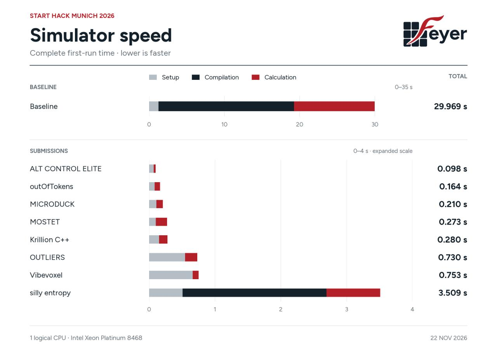

# Differometor, about 300× faster

**1st place in Feyer's "Faster Physics" challenge and 3rd place overall at START Hack Munich 2026** (team ALT CONTROL ELITE).

The task: make [Differometor](https://github.com/artificial-scientist-lab/Differometor), a differentiable simulator for gravitational-wave detectors, as fast as possible on one CPU core, without changing its physical results or its gradients. What counts is the complete first run of a fresh process, including imports and compilation.

On Feyer's final evaluation setup, the unmodified simulator needs **29.969 s**. Ours needs **0.098 s**.



*Feyer's official result chart (22 November 2026, one logical CPU of an Intel Xeon Platinum 8468).*

## What the simulator computes

A detector design is a graph of mirrors, beamsplitters, lasers and free space. The simulator turns it into sparse linear systems and answers three questions: where is the laser light, what does a gravitational wave do to it at each frequency of interest, and how much quantum noise reaches the detector. From that follows the detector's sensitivity. An optimizer then asks for the gradient of that sensitivity with respect to every design parameter and turns all of them a little. The challenge workload is one such step: 101 frequencies, 193 design variables, double precision.

The original runs everything through JAX and XLA with dense 751×751 matrices. More than half of its first run is compilation.

## What we changed

**1. Sparse solves on the host instead of dense solves in XLA.**
The matrices are more than 99 % empty. [`differometor/fast.py`](differometor/fast.py) assembles them as sparse matrices and factorizes them directly. The matrix entries still come from the simulator's own, unchanged component formulas; they are only evaluated with NumPy instead of being traced. Setups this path does not cover fall back to the original JAX code, so nothing stops working.

**2. The physics allows a shortcut.**
Most unknowns of an interferometer are simple: sources, read-only ports, and fields that combine a few others with coefficients of magnitude at most 1. They can be eliminated exactly, with array operations over all frequencies at once. That leaves 200 of 751 unknowns for the solver on the challenge setup and 20 of 82 on aLIGO.

**3. One pivot sequence for all frequencies.**
All 101 systems share one sparsity pattern. A small C kernel ([`pattern_lu.c`](differometor/_native/pattern_lu.c)) factorizes them together with a single pivot sequence, so each arithmetic step becomes a plain vector loop over the frequencies. Every pivot is checked at every frequency. If a check fails, or where the kernel is not available (it is built for x86-64 Linux), the elimination from point 2 followed by SuperLU does the work.

**4. A hand-written reverse pass.**
Signal and noise are read through the same detector weights, so the adjoint the gradient needs already falls out of the forward pass. The gradient costs about a quarter of a forward pass. The derivatives of the physics formulas are not written by hand either: the same component functions are evaluated on dual numbers.

**5. No compiler for a hundred numbers.**
With the physics on the host, the programs left for XLA are a few dozen elementwise operations. [`differometor/_interpret.py`](differometor/_interpret.py) runs such small programs with NumPy instead of lowering and compiling them. Same operations, same inputs, nothing cached.

**6. Start-up.**
After all that, most of the remaining first run is `import jax`. [`differometor/_startup.py`](differometor/_startup.py) removes work from it: modules the run never touches are loaded on first use, the garbage collector pauses during imports, bytecode is shipped. Every measure has its own switch, and the file keeps measures that remove work apart from measures that only move work behind the timers.

**7. A harness without JAX.**
Feyer's [`benchmark.py`](benchmark.py) is untouched. Next to it, [`benchmark_native.py`](benchmark_native.py) runs the same workload and the same correctness checks, but calls the host path directly and never imports JAX. It shows what the simulator itself costs once the framework around it is gone, and it is the harness the official 0.098 s was measured with. (The file still calls itself "not the scored benchmark"; that line was written before the final evaluation.)

## Numbers

Official result on the final setup, measured by Feyer:

| | Complete first run |
| --- | ---: |
| Baseline (unmodified simulator) | 29.969 s |
| This repository, with `benchmark_native.py` | **0.098 s** |

Our own measurements on the two public setups. Same CPU model as Feyer's machine (Xeon Platinum 8468 VM, one logical CPU), first run of a fresh process, measured in alternating series:

| | Feyer's baseline report | `benchmark.py`, our simulator | `benchmark_native.py` |
| --- | ---: | ---: | ---: |
| Challenge setup (3×3 UIFO), first run | 44.204 s | 215 ms | **74 ms** |
| aLIGO, first run | 25.309 s | 185 ms | **44 ms** |
| Challenge setup, each further step | 17.679 s | 28 ms | |

Read these with two caveats. Our values are with a warm file cache; Feyer's baseline reports look like cold runs. Cold against cold, an earlier state of this code needed 1.25 s against 44.2 s with `benchmark.py`. And the "further step" row is from that earlier state too; each number's commit and method is in the notes linked below.

Peak memory is about 300 MB instead of 14.4 GiB (measured in Docker on an Apple M4).

## Correctness

Nothing is precomputed and no calculation is left out. Both public benchmarks print `PASS`, with Feyer's harness and with ours.

- Challenge setup against Feyer's reference: 5.37e-6 in log sensitivity (tolerance 1e-5). The unmodified simulator has the same deviation from that reference.
- aLIGO against Feyer's reference: 2.9e-11 (tolerance 1e-6).
- Against the original dense JAX path on varied setups (random UIFOs of several sizes, aLIGO and Voyager in several modes, other frequency grids, subsets of design variables): 1.5e-7 or better. The one exception is Voyager with amplitude modulation, where we measured up to 9e-6.
- On an ill-conditioned test system (condition number 1e15), the original is 2e-5 away from the exact solution and this code 3e-11.

The test scripts are in [`runs/`](runs), for example `runs/philip/test_genauigkeit.py` (elementwise accuracy), `runs/noel/test_adjoint.py` (reverse pass) and `runs/max/test_interpret.py` (interpreter). Run them with `PYTHONPATH=.` from the repository root.

## Run it

Python 3.12 on Linux or WSL2 (`--cpus 1` needs Linux CPU affinity; on macOS leave it out).

```bash
python3.12 -m venv .venv
source .venv/bin/activate
python -m pip install -r requirements.txt
python -m pip install -e .

# Feyer's harness, unchanged
python benchmark.py --cpus 1 --output benchmark.json
python benchmark_aligo.py --cpus 1 --output benchmark-aligo.json

# our harness without JAX
python benchmark_native.py --cpus 1 --output benchmark-native.json
python benchmark_native.py --cpus 1 --setup aligo --output benchmark-native-aligo.json
```

Or in Docker, pinned to one CPU:

```bash
docker build -t differometor-fast .
docker run --rm --cpus 1 -v "$PWD/out:/out" differometor-fast --repeats 3
docker run --rm --cpus 1 -v "$PWD/out:/out" --entrypoint python differometor-fast \
    benchmark_native.py --cpus 1 --repeats 3 --output /out/benchmark-native.json
```

To compare against the unmodified simulator, check out Feyer's kit ([feyerlabs/start-hack-munich-2026](https://github.com/feyerlabs/start-hack-munich-2026)) and run the same `benchmark.py` there on the same machine. It needs about 14 GiB of memory.

## What to know before using this

- **The fast path covers one kind of setup:** a single quantum noise detector (`qnoised` or balanced homodyne) and a single carrier operating point, with parameter links through a square root (which is what amplitude modulation uses). Other links, carrier sweeps and several noise detectors use the original JAX path, which is correct but as slow as before. `benchmark_native.py` stops with a message for such setups.
- **One known gap in this state:** a beamsplitter beyond the critical angle (total internal reflection) raises an error on the fast path instead of falling back.
- **The start-up measures are benchmark engineering.** They matter for a first run measured in milliseconds and are worth about 0.05 % of an optimization with 10,000 steps. What carries over to real use is the numerical core: each further step is about 630 times faster.
- **Tuned to one environment.** The interventions in JAX are written for jax 0.9.0 and leave other versions alone. The shipped bytecode is for Python 3.12. The native kernel is built for x86-64 Linux; elsewhere SuperLU is used.
- **CPU only.** The original JAX path is still there for anything else.

## Repository map

| Path | What it is |
| --- | --- |
| [`differometor/fast.py`](differometor/fast.py) | Sparse host path and the hand-written reverse pass |
| [`differometor/_native/`](differometor/_native) | C kernel for the shared-pattern LU, with its build script and the built library |
| [`differometor/_interpret.py`](differometor/_interpret.py), [`_tuning.py`](differometor/_tuning.py) | NumPy interpreter for small JAX programs, per-program JAX settings |
| [`differometor/_startup.py`](differometor/_startup.py), [`argparse.py`](argparse.py), [`packaging/`](packaging) | Start-up measures and the two ways they get loaded early |
| [`differometor/_simulate_dicht.py`](differometor/_simulate_dicht.py) | The original dense JAX path, loaded on first use |
| [`benchmark.py`](benchmark.py), [`benchmark_aligo.py`](benchmark_aligo.py) | Feyer's harness, unchanged |
| [`benchmark_native.py`](benchmark_native.py) | Our harness without JAX |
| [`runs/`](runs) | Test scripts, measurement scripts and each author's lab notes |
| [`docs/notes/`](docs/notes) | Working notes from the hackathon |
| [`docs/pitch/`](docs/pitch) | The numbers behind the pitch and the pitch script |
| [`docs/challenge/`](docs/challenge) | Feyer's brief and judging criteria |
| [`benchmarks/`](benchmarks), [`examples/`](examples) | Feyer's baseline reports and the upstream examples, unchanged |

The notes are in German and were written under time pressure, as a lab notebook rather than as documentation. Each one names the commit and machine its numbers belong to. Good entry points: [`docs/pitch/PITCH.md`](docs/pitch/PITCH.md) for the numbers in context, [`docs/notes/PROGRAMMFLUSS.md`](docs/notes/PROGRAMMFLUSS.md) for how the program and its matrices work, [`runs/philip/NOTIZEN.md`](runs/philip/NOTIZEN.md) and [`runs/noel/NOTIZEN.md`](runs/noel/NOTIZEN.md) for every measure with its measurement, and [`runs/philip/FEHLVERSUCHE.md`](runs/philip/FEHLVERSUCHE.md) for what did not work.

## What state this is

The code is what we submitted on 22 November 2026: `differometor/`, the harnesses and the packaging are identical to the submission. Around it, this repository keeps what the submission left out: the tests, the measurement scripts, our notes and the pitch.

## Team

ALT CONTROL ELITE: Philip ([mpb700](https://github.com/mpb700)), Noel Blatter, Max Jäckle ([jmax696](https://github.com/jmax696)) and [Haniubub](https://github.com/Haniubub).

AI coding tools were welcome in this challenge and we used them heavily. Most commits are co-authored with Claude, and [`prototyp/FABLE_PROMPT.md`](prototyp/FABLE_PROMPT.md) is an early prompt we worked from.

One correctness fix goes back to an edge case another team found (a reflectivity of exactly 1); it is credited in [`runs/philip/test_singular.py`](runs/philip/test_singular.py).

## Credits and license

The simulator is [Differometor](https://github.com/artificial-scientist-lab/Differometor) by the Artificial Scientist Lab (commit `b0dc7c7`); its own README is kept as [README.upstream.md](README.upstream.md). The challenge, the benchmark harness, the baselines and the result chart are by [Feyer](https://github.com/feyerlabs/start-hack-munich-2026). [UPSTREAM.json](UPSTREAM.json) is Feyer's record of the original file hashes and describes the kit as supplied, not this modified version.

Everything is under the upstream [MIT license](LICENSE).
